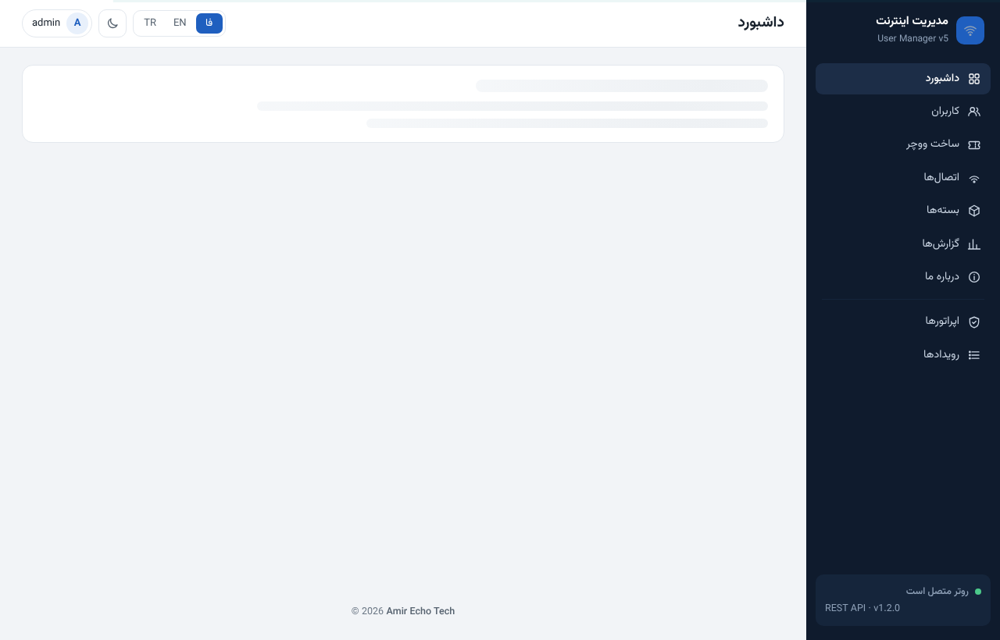

# پنل ادمین UM5



<div dir="rtl">

پنل مدیریت **چندزبانه (فارسی / انگلیسی / ترکی)** برای **MikroTik User Manager
نسخهٔ ۵**. به‌صورت یک کانتینر کوچک (یک فایل اجرایی حدود ۸ مگابایت، بدون سیستم‌عامل)
اجرا می‌شود و روتر را از طریق **REST API** مدیریت می‌کند: ساخت کاربر و ووچر، تمدید
بسته، مشاهدهٔ اتصال‌ها، چاپ کارت، و گزارش مصرف و فروش.

ساختهٔ [Amir Echo Tech](https://amirechotech.ca/).


## محتوای این مخزن

```
images/um5-admin-amd64.tar   ایمیج کانتینر (x86_64)
docker-compose.yml           اجرا روی یک هاست Docker معمولی
INSTALL-FA.md                اجرا داخل خود RouterOS (راهنمای کامل فارسی)
TERMS.md                     شرایط استفاده
docs/                        اسکرین‌شات‌ها
```

## دریافت ایمیج

ایمیج کانتینر **در این مخزن نیست** (فایل باینری است). از این‌جا بگیرید:

- بخش **Releases** ← فایل `um5-admin-amd64.tar`، سپس `docker load -i um5-admin-amd64.tar`
  یا آپلود در **Files** روتر و دنبال‌کردن [INSTALL-FA.md](INSTALL-FA.md).
- یا از **GitHub Container Registry**:
  `docker pull ghcr.io/cybertech1981/um5-admin:1.2.0`

## اجرا داخل RouterOS (پیشنهادی)

راهنمای کامل در **INSTALL-FA.md** است: نصب پکیج container، شبکهٔ veth/bridge،
ساخت یک کاربر API محدود، متغیرها و HTTPS اختیاری. خلاصه: فایل
`images/um5-admin-amd64.tar` را در Files آپلود کنید و یک کانتینر بسازید.

## اجرا روی هاست Docker

```bash
docker load -i images/um5-admin-amd64.tar
# در docker-compose.yml مقادیر ROUTER_URL / ROUTER_USER / ROUTER_PASS / ADMIN_PASS را بگذارید
docker compose up -d
# آدرس http://<host>:8080 را باز کنید
```

بعد از اولین ورود، رمز مدیر را در پنل عوض کنید و `ADMIN_USER` و `ADMIN_PASS` را
از compose حذف کنید.

## کاربر API روتر

برای پنل یک کاربر **محدود** بسازید (هرگز `admin` نه):

```
/user/group/add name=um5-api policy=read,write,api,rest-api
/user/add name=um5-panel group=um5-api address=<شبکهٔ-کانتینر> password="رمز-طولانی-تصادفی"
```

## نقش‌ها

- **مدیر**: همه‌چیز، از جمله حذف کاربر، اپراتورها، بستن جلسه و رویدادها.
- **فروشنده**: دیدن کاربران، ساخت کاربر و ووچر، تمدید، تغییر رمز و غیرفعال‌کردن.

## لایسنس

ایمیج باینری توزیع‌شده. **[TERMS.md](TERMS.md)** را ببینید. استفاده رایگان است؛
سورس منتشر نشده و نام سازنده نباید حذف شود. برای مجوز انتشار مجدد تجاری یا تغییر
برند با [Amir Echo Tech](https://amirechotech.ca/) تماس بگیرید.

**[Amir Echo Tech](https://amirechotech.ca/)** ·
[لینکدین](https://www.linkedin.com/in/amir1360/) ·
[تلگرام](https://t.me/AmirEchoTech)

</div>
