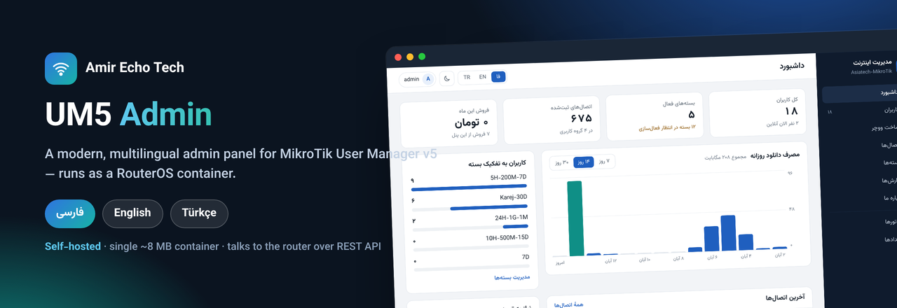
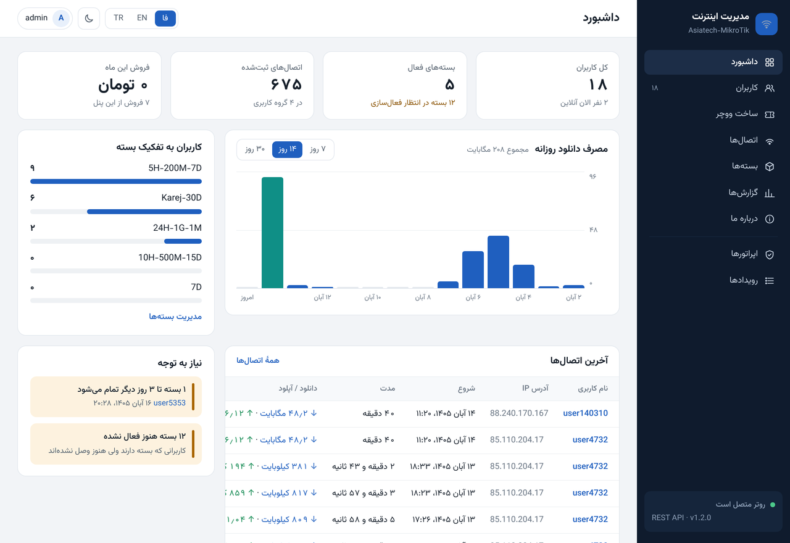
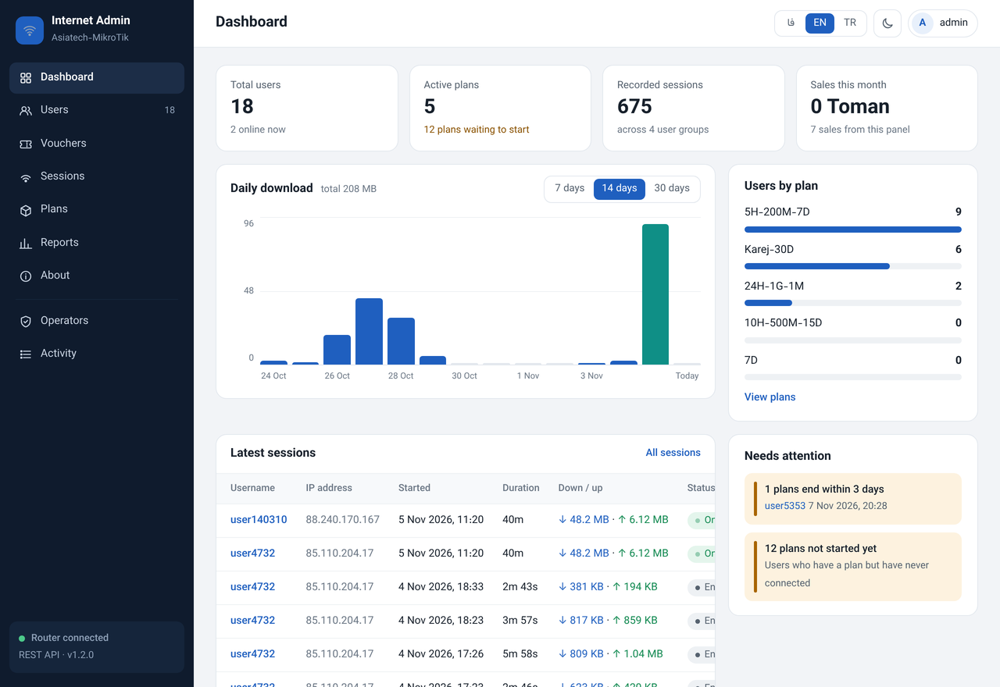
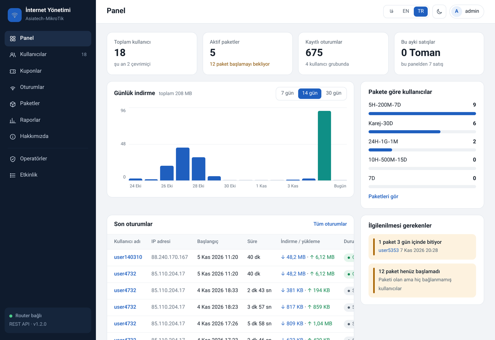
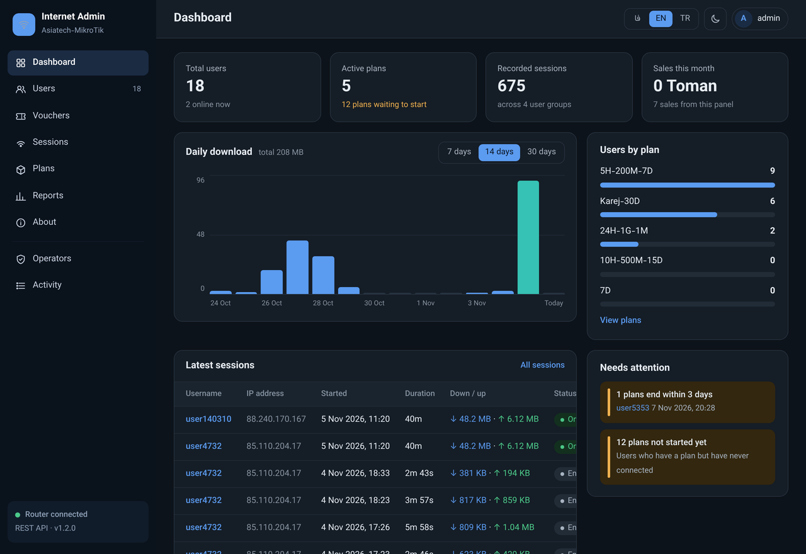
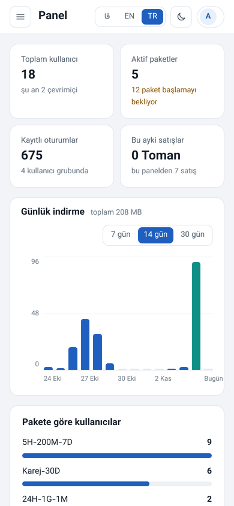

# UM5 Admin



Multilingual (**Persian / English / Turkish**) admin panel for **MikroTik User
Manager v5**. It runs as a single tiny container (a static binary, ~8 MB, no OS
inside) and manages the router over its **REST API** — create users and vouchers,
renew plans, watch sessions, print cards, and read usage and sales reports.

Made by [Amir Echo Tech](https://amirechotech.ca/).

## What's in this repository

```
images/um5-admin-amd64.tar   the container image (x86_64 / amd64)
docker-compose.yml           run it on a normal Docker host
INSTALL-FA.md                run it INSIDE RouterOS as a container (Persian)
TERMS.md                     terms of use
docs/                        screenshots
```

## Screenshots

| Persian (RTL) | English |
|---|---|
|  |  |

| Turkish | English — dark |
|---|---|
|  |  |



## Get the image

The container image is **not** in this repository (it is a binary). Download it from:

- **Releases** → `um5-admin-amd64.tar` (attached to the latest release), then
  `docker load -i um5-admin-amd64.tar`, or upload it to the router's **Files** and
  follow [INSTALL-FA.md](INSTALL-FA.md).
- or **GitHub Container Registry**:
  `docker pull ghcr.io/cybertech1981/um5-admin:1.2.0`

## Run inside RouterOS (recommended)

See **INSTALL-FA.md** for the full step-by-step (container package, veth/bridge,
a restricted API user, env vars, optional HTTPS). In short: upload
`images/um5-admin-amd64.tar` to Files and add a container pointing at it.

## Run on a Docker host

```bash
docker load -i images/um5-admin-amd64.tar
# edit docker-compose.yml: ROUTER_URL / ROUTER_USER / ROUTER_PASS / ADMIN_PASS
docker compose up -d
# open http://<host>:8080  — sign in with ADMIN_USER / ADMIN_PASS
```

After the first sign-in, change the admin password in the panel and remove
`ADMIN_USER` / `ADMIN_PASS` from the compose file.

### Publish it to a registry (optional)

```bash
docker load -i images/um5-admin-amd64.tar
docker tag um5-admin:1.2.0 <your-registry>/um5-admin:1.2.0
docker push <your-registry>/um5-admin:1.2.0
```

## The router user it needs

Create a **restricted** RouterOS user for the panel (never use `admin`):

```
/user/group/add name=um5-api policy=read,write,api,rest-api
/user/add name=um5-panel group=um5-api address=<container-subnet> password="long-random"
```

Put that user in `ROUTER_USER` / `ROUTER_PASS`.

## Roles

- **Admin**: everything, including deleting users, managing operators, closing
  sessions, and the activity log.
- **Seller**: view users, create users and vouchers, renew plans, change
  passwords, disable users.

## License

Distributed binary image. See **[TERMS.md](TERMS.md)**. Free to use; the source
is not published and the author attribution may not be removed. For a commercial
redistribution or rebranding license, contact
[Amir Echo Tech](https://amirechotech.ca/).

---

**[Amir Echo Tech](https://amirechotech.ca/)** ·
[LinkedIn](https://www.linkedin.com/in/amir1360/) ·
[Telegram](https://t.me/AmirEchoTech)
