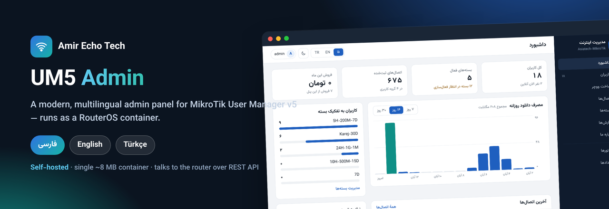
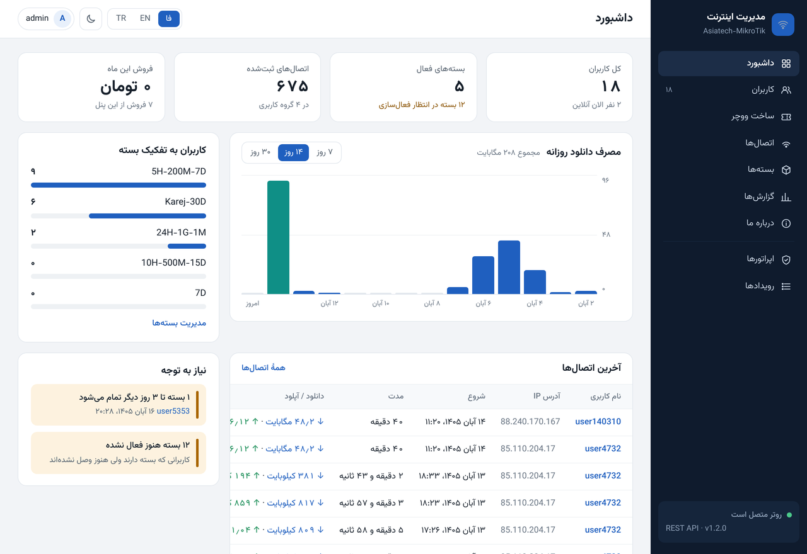
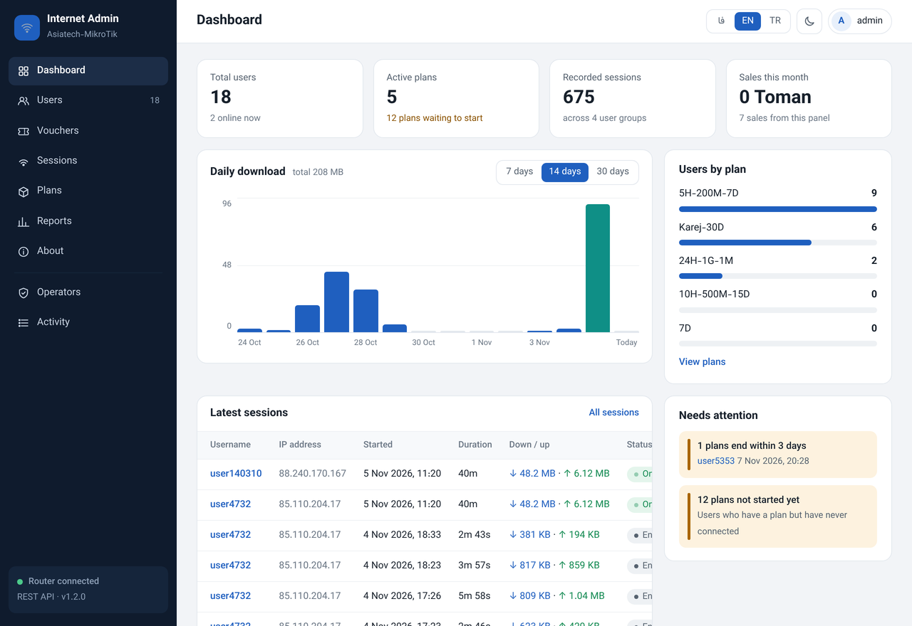
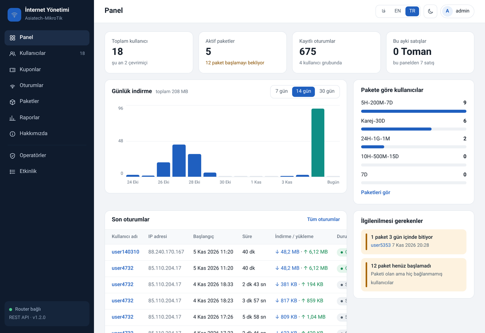
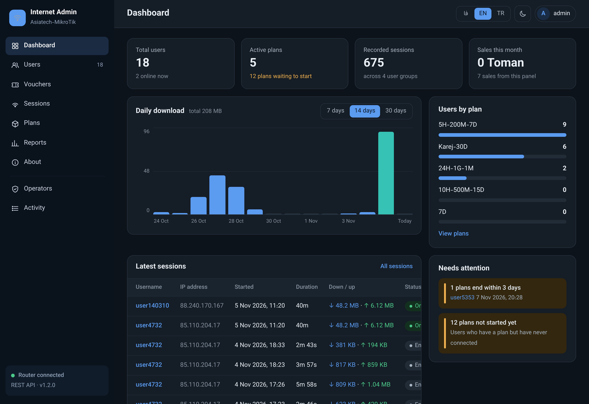
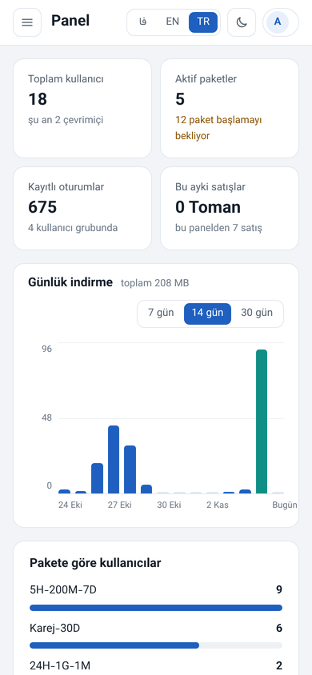

# UM5 Admin



**🌐 Diller:** [English](README.md) · [فارسی](README.fa.md) · Türkçe  
**📖 Kurulum kılavuzu:** [English](INSTALL.md) · [فارسی](INSTALL-FA.md) · [Türkçe](INSTALL-TR.md)

**MikroTik User Manager v5** için çok dilli (**Farsça / İngilizce / Türkçe**) yönetim
paneli. Tek ve küçük bir container olarak çalışır (statik dosya, ~8 MB, içinde
işletim sistemi yok) ve routerı **REST API** üzerinden yönetir — kullanıcı ve kupon
oluşturma, paket yenileme, oturum izleme, kart yazdırma, kullanım ve satış raporları.

[Amir Echo Tech](https://amirechotech.ca/) tarafından yapıldı.

## Bu depoda ne var

```
INSTALL.md / -FA / -TR   RouterOS İÇİNDE container olarak çalıştırma (EN / FA / TR)
docker-compose.yml       normal bir Docker host'unda çalıştırma
TERMS.md                 kullanım şartları
docs/                    ekran görüntüleri
```

Container imajının kendisi burada **yok** — aşağıdaki **İmajı alma** bölümüne bakın.

## Ekran görüntüleri

| Farsça (RTL) | İngilizce |
|---|---|
|  |  |

| Türkçe | İngilizce — koyu |
|---|---|
|  |  |



## İmajı alma

Container imajı bu depoda **yok** (bir ikili dosyadır). Şuradan alın:

- **Releases** → `um5-admin-amd64.tar` (en son sürüme ekli), sonra
  `docker load -i um5-admin-amd64.tar`, ya da routerın **Files**'ına yükleyip
  [INSTALL-TR.md](INSTALL-TR.md) adımlarını izleyin.
- veya **GitHub Container Registry**:
  `docker pull ghcr.io/cybertech1981/um5-admin:1.2.0`

## RouterOS içinde çalıştırma (önerilen)

Her satırın açıklandığı tam adım adım kılavuz — HTTPS, dış erişim ve sorun giderme
dahil — **[INSTALL-TR.md](INSTALL-TR.md)** dosyasındadır. Yedi adım:

**1. Container'ı etkinleştirin (bir kez).** `container` paketi kuruluyken:
```
/system/device-mode/update container=yes
```
Soğuk reboot ile onaylayın (CHR'de Power Off/On).

**2. Kısıtlı bir API kullanıcısı** (panel bununla giriş yapar, `admin` ile değil):
```
/user/group/add name=um5-api policy=read,write,api,rest-api
/user/add name=um5-panel group=um5-api address=172.17.0.0/24 password="API-PASS"
```

**3. Container ağı:**
```
/interface/veth/add name=veth-um5 address=172.17.0.2/24 gateway=172.17.0.1
/interface/bridge/add name=containers
/ip/address/add address=172.17.0.1/24 interface=containers
/interface/bridge/port/add bridge=containers interface=veth-um5
/ip/firewall/nat/add chain=srcnat src-address=172.17.0.0/24 action=masquerade
```

**4. Ortam değişkenleri:**
```
/container/envs/add list=um5 key=ROUTER_URL  value="http://172.17.0.1"
/container/envs/add list=um5 key=ROUTER_USER value="um5-panel"
/container/envs/add list=um5 key=ROUTER_PASS value="API-PASS"
/container/envs/add list=um5 key=ADMIN_USER  value="admin"
/container/envs/add list=um5 key=ADMIN_PASS  value="ADMIN-PASS-8+"
/container/envs/add list=um5 key=TZ          value="Asia/Tehran"
```

**5. Veri mount'u** (operatörler, kuponlar ve etkinlik kaydı burada durur):
```
/container/mounts/add name=um5-data src=um5/data dst=/data
```

**6. Container'ı ghcr.io'dan oluşturun:**
```
/container/config/set registry-url=https://ghcr.io tmpdir=um5/tmp
/container/add remote-image=ghcr.io/cybertech1981/um5-admin:1.2.0 interface=veth-um5 root-dir=um5/root mountlists=um5-data envlists=um5 name=um5-admin start-on-boot=yes logging=yes
```
(Veya `remote-image` yerine Releases'ten `file=um5-admin-amd64.tar` kullanın.)

**7. Başlatın ve kontrol edin:**
```
/container/print            ;# durum = stopped olana kadar bekleyin
/container/start um5-admin
/log/print where topics~"container"   ;# "router OK" beklenir
```
`ADMIN_USER` / `ADMIN_PASS` ile giriş yapın, sonra panelden yönetici şifresini
değiştirip `ADMIN_PASS`'ı kaldırın:
`/container/envs/remove [find list=um5 key=ADMIN_PASS]`

## Docker host'unda çalıştırma

```bash
docker pull ghcr.io/cybertech1981/um5-admin:1.2.0
# docker-compose.yml'yi düzenleyin: ROUTER_URL / ROUTER_USER / ROUTER_PASS / ADMIN_PASS
docker compose up -d
# http://<host>:8080 adresini açın — ADMIN_USER / ADMIN_PASS ile giriş yapın
```

İlk girişten sonra panelden yönetici şifresini değiştirin ve `ADMIN_USER` /
`ADMIN_PASS`'ı compose dosyasından kaldırın.

## Roller

- **Yönetici**: her şey; kullanıcı silme, operatör yönetimi, oturum kapatma ve
  etkinlik kaydı dahil.
- **Satıcı**: kullanıcıları görme, kullanıcı ve kupon oluşturma, paket yenileme,
  şifre değiştirme, kullanıcı devre dışı bırakma.

## Lisans

Dağıtılan ikili imaj. **[TERMS.md](TERMS.md)**'ye bakın. Kullanımı ücretsizdir;
kaynak kod yayımlanmaz ve yazar atfı kaldırılamaz. Ticari yeniden dağıtım veya
markalama lisansı için [Amir Echo Tech](https://amirechotech.ca/) ile iletişime geçin.

---

**[Amir Echo Tech](https://amirechotech.ca/)** ·
[LinkedIn](https://www.linkedin.com/in/amir1360/) ·
[Telegram](https://t.me/AmirEchoTech)
